# Stock Studio

Source-linked, AI-assisted stock research, trade planning and a trading journal in one
multi-tenant SaaS. A member queues a ticker, a research engine builds a dated study grounded
in public filings and retrieved sources (with deterministic output post-checks, not an
independent human audit), and the study then feeds a watchlist thesis hypothesis, LEAPS
scenarios and journal reviews.

**Live:** [stock-studio.onrender.com](https://stock-studio.onrender.com)

The research output is **educational business analysis, never personalized investment
advice**. Every study opens with an "As of [date]" line and ends with a "Not investment
advice" line. Trade signals are the one feature that makes directional calls, under their
own [rules](#content-rules).

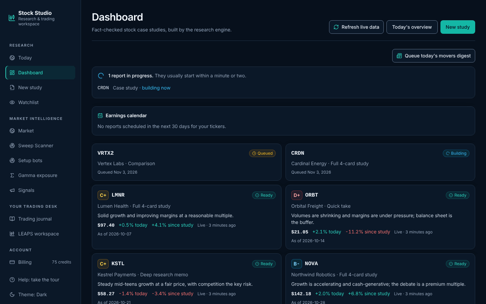

---

## Screenshots

All screenshots use fictional companies and invented figures, rendered from a local preview
database. They show layout only, not real research or market data.

| | |
|---|---|
| 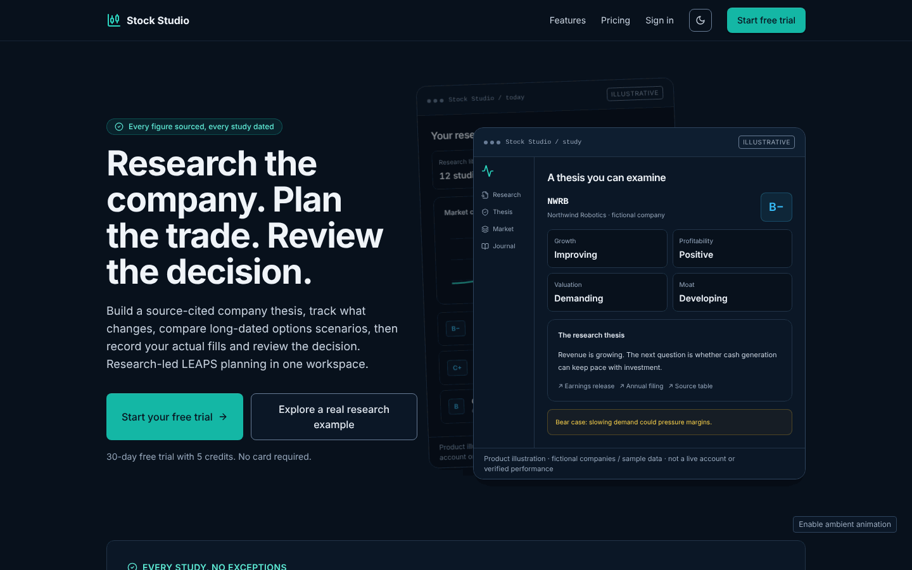 | 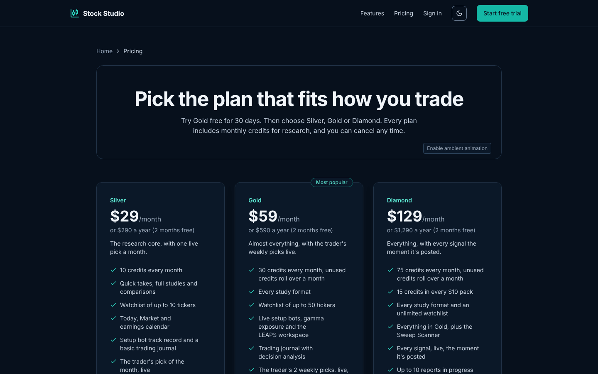 |
| **Home.** Public landing page with the product tour. | **Pricing.** Silver, Gold and Diamond coaching tiers. |
| 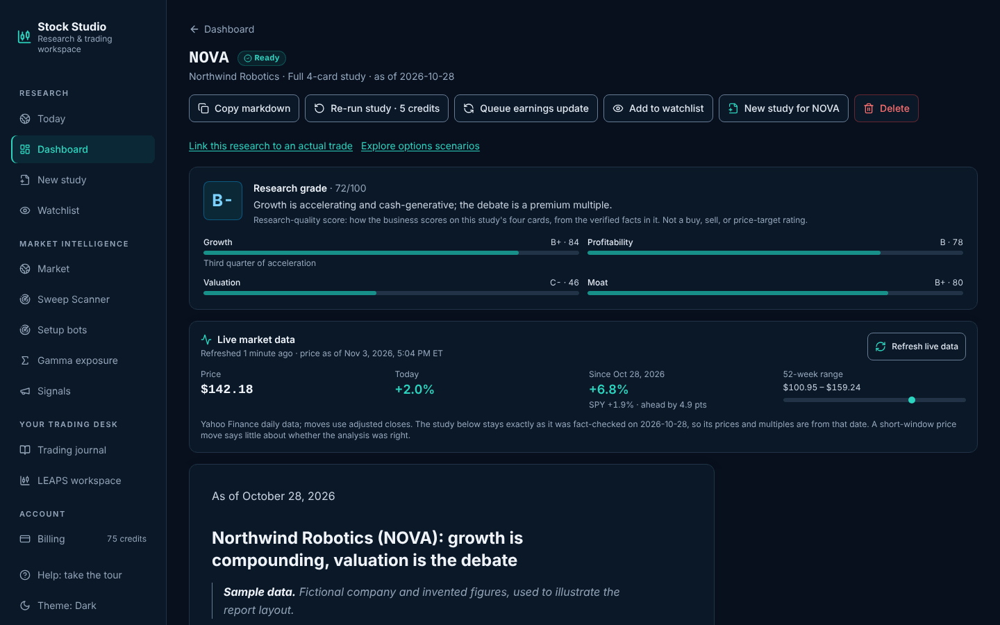 | 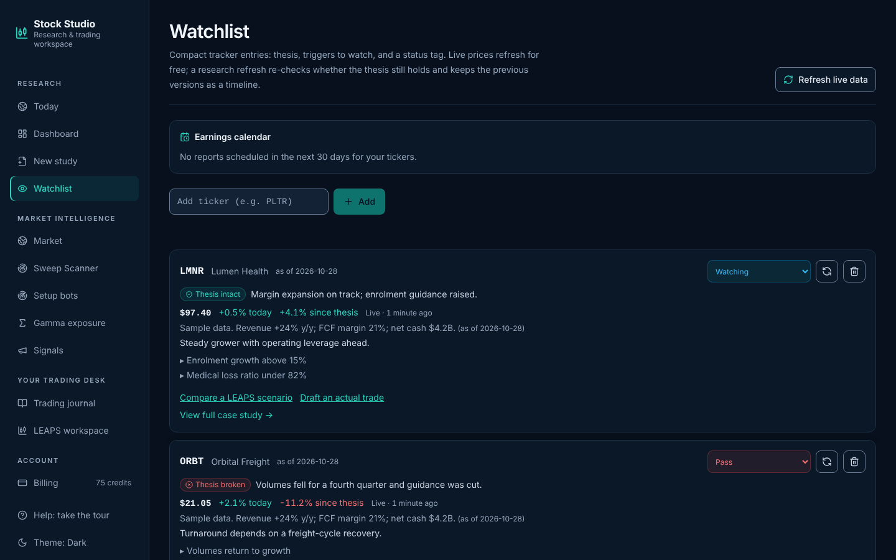 |
| **Study.** Research grade, live quote since the as-of date, and the sourced report. | **Watchlist.** Thesis tracker (intact, weakening, broken), triggers and live prices. |
| 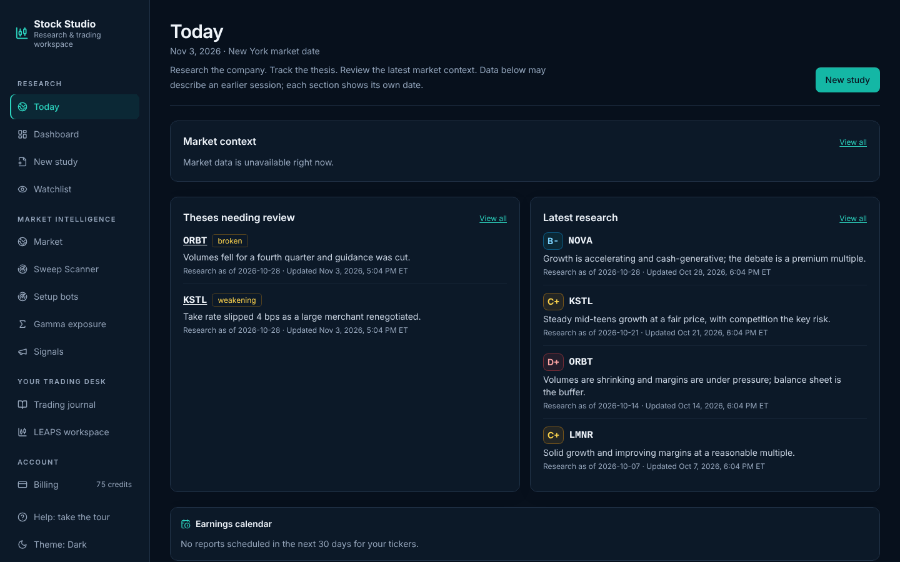 | 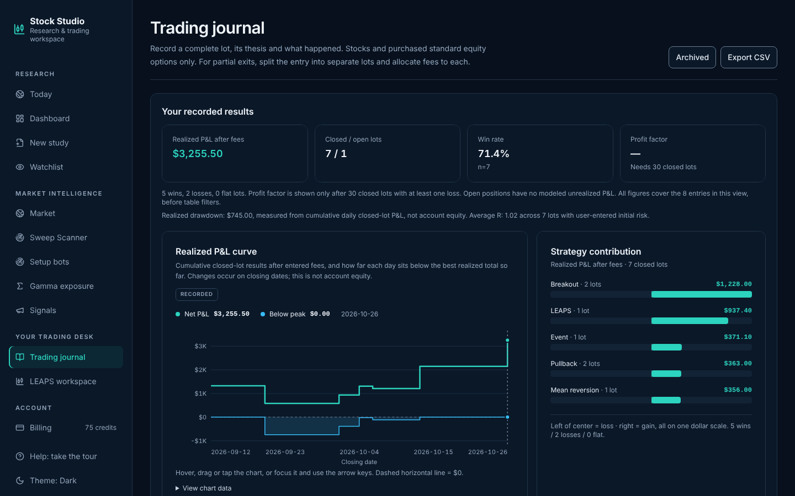 |
| **Today.** Daily overview of theses needing review, latest research and earnings. | **Trading journal.** Realized P&L, drawdown, win rate and strategy contribution. |
| 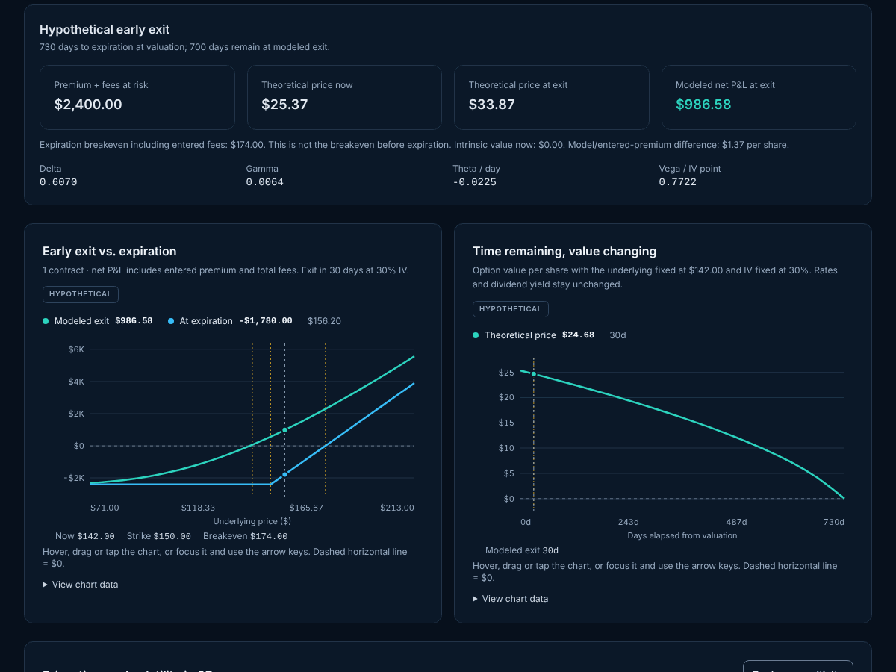 | 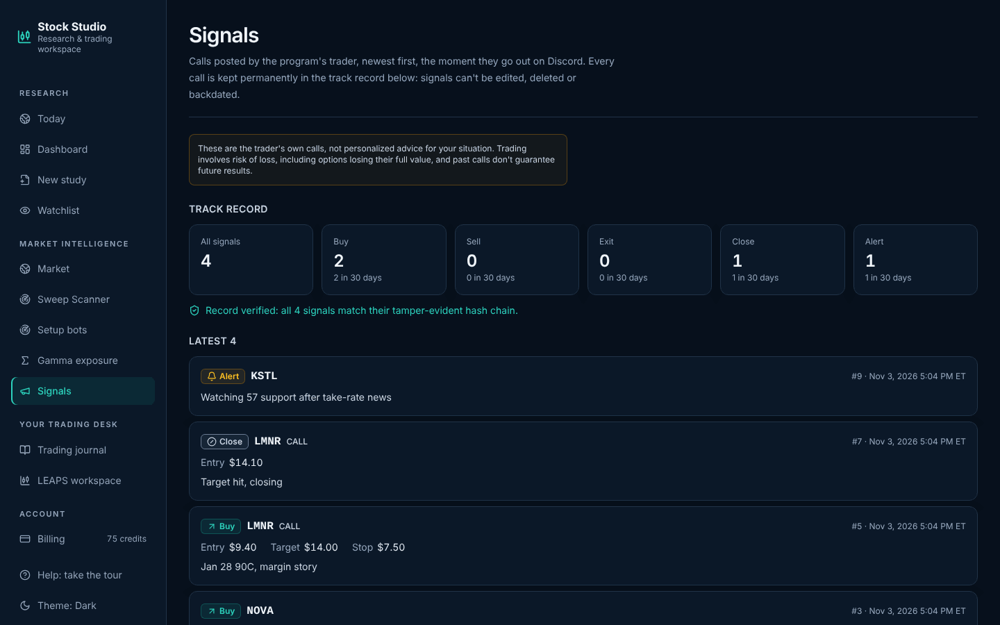 |
| **LEAPS workspace.** Black-Scholes scenarios, early exit vs. expiration, time decay. | **Signals.** The trader's calls with a hash-chained, verified track record. |
| 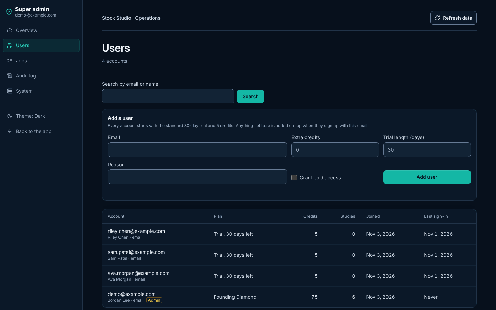 | |
| **Admin console.** Add, invite, disable and audit members. | |

On a phone the sidebar collapses into a menu and every page reflows to one column:

<p>
  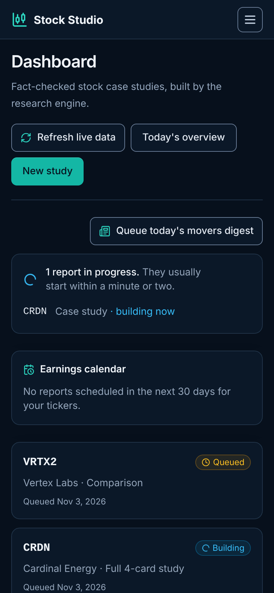
  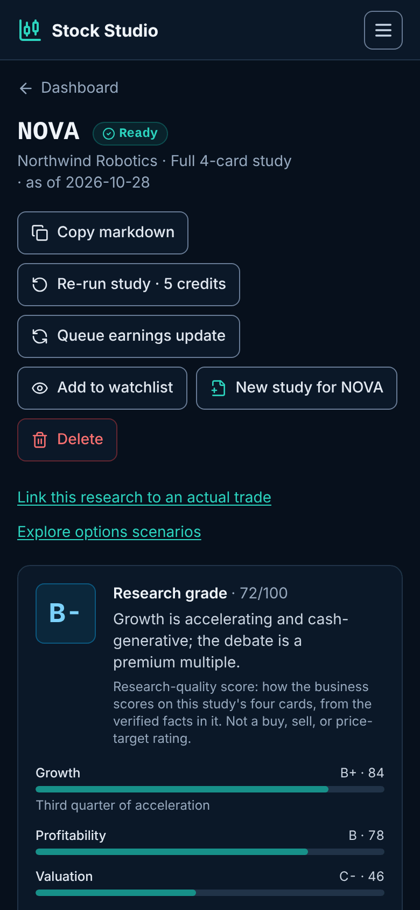
  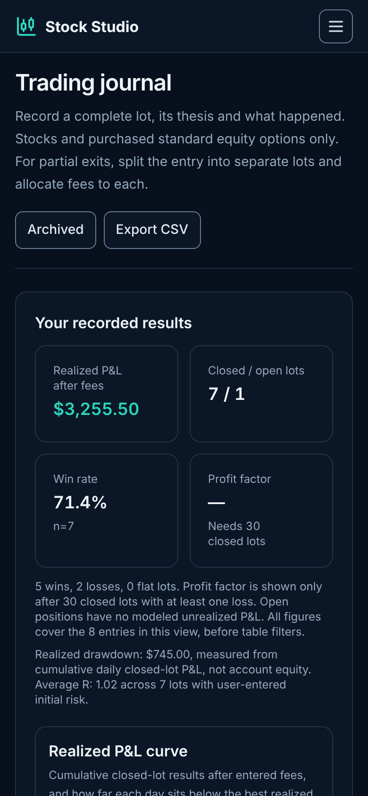
</p>

---

## Features at a glance

| Area | Pages | What it does |
|---|---|---|
| Research | `/new`, `/dashboard`, `/study/[id]` | Queue a study in one of 12 formats; get a graded, source-cited report. Re-run or queue an earnings update from the study page. |
| Thesis tracking | `/watchlist` | Thesis, snapshot and triggers per ticker; every refresh judges the thesis intact, weakening or broken and keeps the history. |
| Live market data | dashboard, study, watchlist | Free quote refresh (price, day move, move since the as-of date vs. SPY, 52-week range) without touching the study text. |
| Daily overview | `/today`, `/market` | Theses needing review, latest research, earnings, sector and breadth context, biggest movers. |
| Scanners | `/setups`, `/gamma`, `/sweeps` | Rule-based setup bots with paper-tracked records, dealer-gamma model from CBOE chains, Sweep Scanner preview. |
| Trading desk | `/journal`, `/leaps` | Self-reported trading journal with P&L analytics and CSV import/export; LEAPS chain discovery and scenario modeling. |
| Signals | `/signals` + Discord | The program trader's calls, relayed to Discord and kept in an append-only, hash-chained record. |
| Offline PWA & push | `/offline`, `/billing` | Installable standalone PWA with Service Worker caching, IndexedDB workspace snapshot + FIFO mutation outbox, and RFC 8291/8292 Web Push alerts. |
| Membership | `/pricing`, `/billing` | 30-day trial, then the Silver, Gold or Diamond coaching tier: a program fee paid outside the app, then a monthly subscription with credits. |
| Operations | `/admin` | Super admin console: users, invites, jobs, audit log, system health, failure alerts. |

### Stack

- **App**: Next.js 16 (App Router, React 19), Tailwind. Runs locally on port 3200; deployed on Render (Vercel also works).
- **Database**: hosted Postgres on Supabase, in an isolated `stocks` schema.
- **Auth**: Supabase Auth (email/password and Google). Each signup gets its own workspace.
- **Billing**: Stripe monthly subscriptions, one per coaching tier.
- **Research engine**: an automated Anthropic API worker, with a manual CLI fallback.
- **Market data**: unauthenticated Yahoo Finance endpoints (no API key) first, with optional keyed fallbacks (Massive, Tiingo, Twelve Data, Finnhub, Alpaca) when Yahoo rate-limits the host; CBOE delayed option chains for LEAPS and gamma, with Massive or Finnhub standing in when CBOE fails.

---

## Contents

- [Screenshots](#screenshots)
- [Features at a glance](#features-at-a-glance)
- [What it produces](#what-it-produces)
- [Insights: grades, thesis tracking, earnings, market context, setup bots, gamma](#insights-grades-thesis-tracking-earnings-market-context-setup-bots-gamma)
- [Live market data](#live-market-data)
- [Sweep Scanner (preview)](#sweep-scanner-preview)
- [Trade signals](#trade-signals)
- [Offline-first PWA & Web Push](#offline-first-pwa--web-push)
- [Design and motion](#design-and-motion)
- [Architecture](#architecture)
- [Getting started](#getting-started)
- [Environment variables](#environment-variables)
- [The research engine](#the-research-engine)
- [Billing](#billing)
- [Accounts & sign-in](#accounts--sign-in)
- [Admin console](#admin-console)
- [Multi-tenancy & security](#multi-tenancy--security)
- [Database](#database)
- [CLI scripts](#cli-scripts)
- [Project structure](#project-structure)
- [Deployment](#deployment)
- [Content rules](#content-rules)
- [Troubleshooting](#troubleshooting)

---

## What it produces

| Format (`variant`) | What you get | Credits |
|---|---|---|
| `quick_take` | 1–2 sentence verdict plus one condensed card | 2 |
| `full` | 4-card study: growth, profitability, valuation, moat, plus a bear case | 5 |
| `carousel` | Tight copy sized for IG/TikTok/LinkedIn slides | 5 |
| `newsletter` | Newsletter section with paragraphs, subheads and a narrative arc | 5 |
| `script` | Video script: voiceover lines plus on-screen text per card | 5 |
| `memo` | Deep research memo: source table, bear/base/bull cases, valuation sensitivity | 8 |
| `comparison` | Two or more tickers side by side | 3 |
| `earnings_update` | Post-earnings changes against a prior study (from a study's page) | 3 |
| `one_candle` | One-candle intraday setup check (educational framework) | 2 |
| `davinci_model` | "Da Vinci" liquidity model check (educational framework) | 2 |
| `movers_digest` | Today's top 5 gainers and losers, each with a verified story (dashboard button) | 3 |
| watchlist entry | Tracker row: thesis, snapshot, 2–3 triggers, status tag | 3 |

Prices live in one place, `CREDIT_COSTS` in [`lib/shared.ts`](lib/shared.ts). The `/pricing`
page, the New Study form and the charge made at queue time all read from it, so change prices
there and nowhere else.

The **one_candle** and **davinci_model** variants are strictly educational framework analysis
built only from real fetched candles. They give no trade directives and make no profitability
claims, and each has its own required footer. See [`lib/engine/methodology.md`](lib/engine/methodology.md) for
the full methodology of each.

---

## Insights: grades, thesis tracking, earnings, market context, setup bots, gamma

- **Today (`/today`).** A signed-in daily overview of the latest research, weakening or broken
  watchlist theses, earnings for followed companies, market context, the latest completed setup
  scan and recent member signals. Each section loads independently, so an unavailable feed does
  not hide the rest of the overview. Research and watchlist queries are scoped to the server-resolved
  workspace. Signal previews use the same paid-access/admin gate as `/signals`; trial users do not
  see the feed. Opening Today does not queue research, call the AI provider or charge credits.
  Today and Market reuse cached market data and coalesce concurrent uncached loads within a process.
  Market-wide caches never contain workspace data.
- **Data timestamps.** Gamma distinguishes CBOE's source timestamp from the time Stock Studio
  retrieved the chain. Missing or timezone-ambiguous source timestamps are explicitly unknown;
  retrieval time is never presented as evidence of freshness. The delayed-feed label remains visible.
  Daily market bars identify their session date and may be in progress during trading hours.
  No paid data feed is required. The journal and saved LEAPS scenarios below require their
  additive storage migration before the new app version is deployed.

### Trading journal (`/journal`)

- Record long/short stock lots and purchased standard 100-share calls or puts, with entry/exit
  prices, dates, total fees, strategy, thesis, review and optional initial dollar risk.
- Link an existing study from the same workspace. App queries scope every read and mutation;
  a database trigger also rejects cross-workspace study links. RLS is enabled, while public
  API roles retain no grants on these private tables.
- Edit or close a full lot. Archive and restore entries instead of deleting them. An integer
  revision prevents one edit from silently overwriting a concurrent edit or archive.
- Review realized P&L after fees, wins/losses, results by strategy, cumulative realized P&L,
  daily realized drawdown and average R for lots with entered initial risk. Profit factor
  requires at least 30 closed lots and a loss. These are self-reported results, not broker
  verification; open positions are not marked to market.
- CSV imports use a downloadable template, preview, full validation and an atomic commit.
  At most 500 rows / 1 MB per file. Map broker columns to the template first; this is not an
  automatic parser for every broker's transaction export. Dates are `YYYY-MM-DD`, prices are
  per share, fees cover the entire lot, and exits require both date and price. A zero exit
  price records a worthless closed option.
- Use a unique **broker-prefixed** `source_ref` for each lot. Repeat import keys are scoped
  to a workspace. Without a reference, identical economic lot fields are treated as repeats;
  distinct identical fills need distinct references. Archived imported lots retain their key.
  CSV export protects spreadsheet cells from formula injection.
- Partial exits must be split into separate lots, with fees allocated to each. Adjusted
  contracts, spreads and short options are unsupported. Each active/archived view is bounded
  to 10,000 entries and fails explicitly beyond that limit instead of reporting truncated totals.

### LEAPS workspace (`/leaps`)

- Load CBOE's delayed options chain on demand, or enter manual assumptions when the feed is
  unavailable. The chain view includes supported roots with at least 365 days remaining,
  expirations up to four years and strikes within 50% of the underlying. It displays the first
  500 matches, sampling strikes nearest the underlying across expirations and option types
  to preserve expiration coverage. Sampling is not a contract recommendation. Quotes carry source time when available and a
  separate retrieval timestamp. Missing bid/ask/IV/volume/OI stays missing.
- Compare expiration, quoted bid/ask spread, IV, volume and open interest. Copying a contract
  is not an order or fill. IV percentages are converted from the feed's decimal IV; interest
  rates, dividend yield and future volatility remain explicit user assumptions.
- European Black-Scholes with continuous dividend yield computes price, delta, gamma,
  theta per day and vega per IV percentage point. Scenario P&L uses the entered premium,
  contract count, fees, remaining time, underlying move and exit IV. It also shows an
  expiration-only breakeven, price scenarios, fixed-price time decay and hypothetical
  180/365/730-day comparisons. At expiration, the model uses intrinsic payoff.
- This approximation does **not** model American early exercise, discrete dividends, skew,
  assignment, taxes or slippage. It is not a quote or forecast; model prices may differ
  materially from premiums. See [OIC model limitations](https://www.optionseducation.org/advancedconcepts/black-scholes-formula)
  and [LEAPS pricing](https://www.optionseducation.org/optionsoverview/leaps-pricing).
- Save, load, archive and restore private assumption sets. Loading a saved set preserves its
  original date and premium; it does not refresh market observations. The list shows the latest
  100 saved sets in the selected view. Logging a real trade requires actual journal entry data.
- Journal writes and saved-scenario writes require paid access or an active trial, with no
  credit charge. Signed-in users can still read/export their journal after a trial ends and
  use the manual model. Chain requests and calculations make no AI-provider calls.

#### Research-led decision workflow

Studies and tracked theses now link into LEAPS planning with workspace- and ticker-checked research context. Scenario saves retain this context inside the existing inputs JSON. Both saved and unsaved scenarios can open a journal draft carrying option type, strike, expiry, contract count and linked research. Entry/exit fill prices are always blank in new drafts; a scenario is not a trade. The journal still requires actual executed prices and dates. No schema migration is needed, and older scenarios remain loadable.

LEAPS discovery filters the existing sampled CBOE feed by expiry/remaining days, absolute provider delta, quoted spread as a percentage of midpoint, volume, open interest and ask-based premium budget. Blank filters are disabled; unknown values fail active filters. Budget is ask × 100 × selected contracts plus user-entered total entry/exit fees (zero by default). Calls/puts and expiration stay explicit, and the interface discloses feed sampling, delay and missing values. This is a single-ticker sampled discovery tool, not a complete cross-market scanner or recommended-contract ranking.

Journal decision review uses active closed lots, actual calendar holding periods and realized dollar P&L after entered fees. It shows historical expectancy per lot (including flat lots), win/loss averages, holding-period buckets, linked-study results, review completion and a month calendar that opens actual lot review. Partial-exit lots count separately. No unrealized prices, deposit-based returns or performance forecasts are inferred.

The public `/examples` page uses a manually prepared, dated Apple fiscal Q3 2026 excerpt (`lib/public-example.ts`) linked to Apple's release and SEC 8-K. Its interactive demo uses separately labeled invented option assumptions and disposable local state, with no orders, account data or automatic copying of model prices into fill fields.

#### LEAPS contract comparison

Discovery results can be sorted by expiration/strike, ask-based lot cost, quoted spread percentage, absolute provider delta or open interest. Unavailable values sort last in either direction; sorting is not a recommended-contract ranking. Select up to three contracts from one loaded chain snapshot for side-by-side liquidity, expiry, provider Greeks, fee-inclusive lot cost and expiration breakeven comparisons. Selections survive filter and option-type changes with a visible out-of-filter label; reloading a chain clears them. Selection is local to the page and is not a saved watchlist.

Costs use the delayed ask, standard 100-share contract count and entered total fees. Missing, zero-ask, crossed or nonfinite quotes never become zero-cost candidates or invented midpoint fills. Zero bids remain visible and do not establish sell-side liquidity. Comparison costs and breakevens are quote-based assumptions, not forecasts, early-exit breakevens or actual trade results. Loading a selected contract copies contract count and assumed fees into the existing scenario model; journal drafts continue to require actual fill prices. No new API calls, polling, database migration or AI usage is introduced.

Before deploying journal/LEAPS routes, review and apply
`supabase/migrations/20261013083434_trading_journal_and_leaps.sql` through your migration workflow.
It creates only `stocks.journal_trades`, `stocks.leaps_plans`, their indexes, RLS and the study-scope
trigger. It does not change old trades/signals/reports or grant public API access. Migration tests
replay it against the existing baseline locally. Production rollout is separate from committing
these application changes.

These features are adapted from [QuantEdgeResearch](https://github.com/Maleek23/QuantEdgeResearch). Each one was
narrowed to fit Stock Studio's educational, no-advice framing for research features. Trade execution and
options-flow alerts were left out. Directional trade calls and Discord/SMS signal alerts are now a separate
feature, [Trade signals](#trade-signals), with its own rules.

- **Research grade and one-line summary.** Fundamental studies get a letter grade (A to F) built from four card
  scores: growth, profitability, valuation (higher means more reasonable) and moat.
  - The engine scores each card from the verified facts in the study.
  - [`lib/grades.ts`](lib/grades.ts) computes the letter from the average of the four scores, on bands that follow
    the scoring calibration: 70+ (✅ cards) is A to B-, 45–69 (⚠️, with 50 = unremarkable) is C+ to C-, and
    below 45 (🔴) is D+ to F (F only under 30). The letter is re-derived from the stored score when shown.
  - Each study also gets a one-sentence "what this means" line, shown on dashboard cards.
  - The grade is labelled a research-quality score, never a buy or sell rating.
- **Thesis tracker.** Every watchlist refresh judges the previous thesis as intact, weakening or broken, and cites
  the development that decided it.
  - Every version is kept (`watchlist_history`) and shown as a timeline.
  - Study pages show how the price has moved since the as-of date, next to SPY.
- **Earnings calendar.** Upcoming and just-reported earnings dates for your watchlist and studied tickers come from
  Nasdaq's public calendar. A just-reported ticker links to its study, where you can queue an earnings update.
- **Market context (`/market`).** Shows:
  - sector ETFs against SPY over 1 day, 5 days and 1 month;
  - large-cap breadth: the share above the 50- and 200-day averages, advancers and decliners, and names near
    52-week highs and lows;
  - today's biggest movers;
  - plain-English readings generated from those numbers.

  Market data is cached for about 30 minutes (Next's fetch cache).
- **Setup bots (`/setups`).** Five rule-based scanners check about 100 large caps after every close for published
  chart patterns: 52-week breakout, RSI(2) pullback in an uptrend, pullback to a rising 50-day average, unusual
  volume, and post-earnings gap.
  - A match lists the pattern's own reference and failure levels. It is never a buy/sell call.
  - One model call per scan writes descriptive "desk notes"; any note that reads like advice is dropped.
  - Every match is paper-tracked against SPY over the bot's horizon, and the page shows each bot's record.
  - The worker runs the scan once per completed session. `npm run engine -- scan-setups [--force]` runs it by hand.
- **Gamma exposure (`/gamma`).** A dealer-gamma model for SPY, SPX, QQQ, IWM or any optionable symbol, built from
  CBOE's free delayed chains. It shows net gamma per 1% move, the zero-gamma level, the largest call and put
  strikes, and a strike-by-strike chart, with the model's assumptions spelled out on the page.

---

## Live market data

Finished studies and watchlist rows carry a live quote next to the research: price, today's
move, the move since the study's as-of date against SPY, and the 52-week range. It is stored
as `live_json` / `live_refreshed_at` on `case_studies` and `watchlist`
(migration `20261026160000_live_market_data.sql`), so the study's own text, figures and
sources are never changed.

- **Refresh live data** (dashboard, watchlist, study page) calls `POST /api/live-refresh`
  with `{ scope: "study" | "watchlist", id }` or `{ scope: "all" }`. It is free and makes no
  AI call. Rows refreshed in the last minute are skipped; Silver refreshes each row at most
  once a day (`liveRefreshCooldownHours` in `lib/plans.ts`).
- A study page pulls a new quote on view once the stored one is more than 30 minutes old.
- **Re-run study** is different: it queues a new paid study with fresh research.
- Logic lives in [`lib/live-data.ts`](lib/live-data.ts); quotes come from Yahoo with the
  Alpaca fallback described under [Environment variables](#environment-variables).

---

## Sweep Scanner (preview)

Capture/replay tooling and the protected `/sweeps` preview are available. Live detection is not enabled. Historical tapes and an opt-in capture worker are now included; see [source reconciliation](docs/sweep-scanner/historical-evidence.md) and [worker deployment](deploy/sweep-scanner/README.md). See [setup and method blockers](docs/sweep-scanner/README.md) and the [initial delivery report](docs/sweep-scanner/delivery-report.md).

---

## Trade signals

The program trader's own calls (BUY, SELL, EXIT, CLOSE, ALERT, with optional entry, target and stop),
reposted to members. This is the one feature that makes directional trade calls; the research features
above stay educational.

- **Posting.** The trader types one line in a private Discord channel, e.g.
  `BUY GOOGL CALL @12.40 tp 15 sl 11 breakout over 285`. Within about a minute the signal relay
  (a Supabase Edge Function run by pg_cron, [`supabase/functions/signal-relay`](supabase/functions/signal-relay/README.md);
  logic in [`lib/signal-relay.ts`](lib/signal-relay.ts), parser [`lib/signals.ts`](lib/signals.ts)) records
  it, then posts a formatted signal to the members' channel. The always-on gateway bot
  ([`scripts/signal-bot.ts`](scripts/signal-bot.ts)) does the same instantly but needs a host that stays up.
- **Who can post.** Only Discord user IDs listed in `SIGNAL_POSTER_IDS`. The bot refuses to start without
  at least one, and anyone else gets a ⛔ with nothing posted.
- **Track record.** `stocks.signals` in Postgres: append-only (updates, deletes and truncates are refused by
  triggers, for every role), timestamped by the database, and SHA-256 hash-chained row to row.
  `stocks.verify_signal_chain()` recomputes the chain; `/signals` shows the result. Deliveries go in the
  insert-only `stocks.signal_deliveries`. A signal is recorded before it's posted, and a message is
  recorded once even if processed twice.
- **Roles.** The bot connects as `stocks_signals` (`SIGNALS_DATABASE_URL`), which can only insert and read
  those two tables. The web app's role can only read them.
- **Who sees it.** `/signals` is for members with paid access (`profiles.access_granted`) and platform
  admins, not trial accounts. No credits are charged. Like setup scans, signals are program-wide data
  without a `workspace_id`.
- **Secrets.** The bot token lives only in the relay's Supabase function secrets (or the gateway bot's
  host env). Deploy steps: [`supabase/functions/signal-relay/README.md`](supabase/functions/signal-relay/README.md);
  gateway bot: [`deploy/signal-bot/README.md`](deploy/signal-bot/README.md).
- **SMS.** The rules allow SMS alerts and `signal_deliveries` accepts an `sms` channel, but no SMS
  sender is built yet.

---

## Offline-first PWA & Web Push

Stock Studio installs as a standalone Progressive Web App (`app/manifest.ts`, `public/sw.js`) on
desktop, Android and iOS (Home Screen standalone mode) and keeps your workspace readable and
writable when connectivity drops.

- **Offline workspace library (`/offline`).** Signed-in sessions sync a workspace-scoped snapshot
  (`GET /api/offline/snapshot` → IndexedDB `stock-studio-pwa`) holding finished case studies
  (pre-sanitized HTML + cited sources), watchlist theses/triggers, active journal lots, saved LEAPS
  plans and entitled trade signals. The Service Worker caches static bundles (`/_next/static/*`)
  cache-first and HTML navigations network-first with an automatic `/offline` fallback.
- **FIFO offline outbox (`lib/offline/store.ts`).** Queuing a new study, adding/retagging a
  watchlist ticker, logging/editing/archiving a journal trade, or saving a LEAPS scenario while
  offline stores the validated mutation in IndexedDB and replays it in order when online (or via the
  Service Worker `ss-outbox-sync` Background Sync event). Signing out purges IndexedDB, private
  Service Worker caches and the device's push endpoint so shared browsers retain no member data.
- **Web Push notifications (`lib/push.ts`, `lib/push-dispatch.ts`, `/api/push`).** Pure Web Crypto
  RFC 8291 (`aes128gcm`) + RFC 8292 (`VAPID` ES256) push delivery with zero external dependencies.
  Members opt in per device from the sidebar **Alerts & offline** button, `/signals`, or `/billing`
  and choose categories:
  - **Case studies**: finished report (with research grade) or refunded build error.
  - **Watchlist**: refreshed thesis status (`intact`, `weakening`, `broken`), raised to high urgency
    when a thesis weakens or breaks.
  - **Live signals**: enqueued by trigger (`stocks.signal_push_queue`) and drained by the worker
    using `stocks.signal_push_recipients()`, enforcing the same Diamond/Gold/Silver weekly-pick rule
    as the web feed and excluding trial, expired and disabled accounts. Signals older than 30 minutes are
    never pushed after an outage.
- **Database migration.** Apply `supabase/migrations/20261111000000_pwa_push_notifications.sql`
  before enabling push in production, and generate VAPID keys with `npm run vapid-keys`.

---

## Design and motion

Public home and pricing pages use a lazy-loaded Three.js / React Three Fiber / Drei
decorative scene. It runs on desktop only when visible, respects reduced-motion
preferences, and offers a pause control. Product screenshots reveal as they enter
the viewport where scroll-driven CSS is supported. WebGL failure keeps the static
page usable. These visuals are abstract and never represent live market data.

The product tour and first-run onboarding share a layered research → thesis →
journal preview. The optional LEAPS 3D explorer reuses the deterministic pricing
model for price/time/IV comparisons while keeping exact values accessible in the
numeric readout and existing SVG charts. Its sliders are local illustrations and
do not save scenarios. Motion visibility, pause controls, WebGL fallbacks, canvas
defaults, page headers and range inputs live in reusable components under
`components/motion` and `components/ui`.

The navy/teal theme uses shared CSS tokens in both dark and light mode. Explicit
root and marketing-shell backgrounds prevent default canvas/background colors
from showing through. Text, accents, input borders and primary-button contrast
were checked against both palettes.

Marketing product previews are responsive HTML/SVG illustrations using the same
theme tokens as the app, including journal and LEAPS previews. They use fictional
companies and synthetic values, with visible sample-data labels. The “How it
works” and format cards follow the selected theme rather than fixed light colors.

---

## Architecture

The active migration targets **Neon Postgres and self-managed Better Auth**.
See [the migration and cutover guide](db/README.md) for validation status,
required secrets, role boundaries, scheduling and rollback. Historical SQL
in `supabase/` remains the application schema history; it is not the runtime
authentication provider.

```
            ┌──────────────────── Next.js app (Render or Vercel) ─────────────────────┐
 browser ──▶│ (marketing)  /  /pricing  /terms  /privacy          ← public            │
            │ (app)        /today /dashboard /new /watchlist /study/[id] /journal     │
            │              /leaps /market /setups /gamma /signals /billing  ← session │
            │ admin/       users · jobs · audit · system           ← super admin      │
            │ api/         case-studies · watchlist · jobs · journal · leaps          │
            │              live-refresh · billing/checkout · portal ← session         │
            │              billing/webhook   ◀── Stripe            ← signature        │
            │              engine/run        ◀── Postgres          ← shared secret    │
            └───────┬─────────────────────────────────────────────────────▲──────────┘
                    │ postgres (stocks_app role)                          │ pg_net POST
            ┌───────▼─────────────── Supabase: schema "stocks" ───────────┴──────────┐
            │ jobs ──INSERT trigger──▶ notify_job_inserted()  +  pg_cron every minute │
            │ case_studies · watchlist · workspaces · profiles · credits_ledger ·    │
            │ payments · RPCs: claim_job, charge/refund_job_credits, fulfill_checkout │
            └─────────────────────────────────────────────────────────────────────────┘
                    ▲
                    │ npm run engine (CLI)  ← manual fallback
```

**Lifecycle of a report:**

1. A user submits `/new`. `POST /api/case-studies` checks access, then in **one transaction**
   inserts the `case_studies` row (status `queued`) and the `jobs` row, and charges credits.
2. The job INSERT fires a Postgres trigger that POSTs to `/api/engine/run`. A `pg_cron` job
   repeats that POST every minute as a backstop.
3. The worker claims the job (`claim_job()`, which marks the study `building`), fetches market
   data and/or researches, calls the Anthropic API, and writes the markdown back (`ready`).
4. On a permanent failure the job and study are set to `error` and the credits are refunded.
5. The dashboard refreshes itself while jobs are pending.

---

## Getting started

### Prerequisites

- Node 20+
- Access to the Supabase project that hosts the `stocks` schema, including a password for the
  `stocks_app` role
- (Optional) an Anthropic API key, and Stripe test-mode keys

### Install & run

```bash
npm install
cp .env.example .env.local      # then fill it in (see below)
npm run dev                     # http://localhost:3200
```

Local development needs `DATABASE_URL`, `AUTH_DATABASE_URL`, `BETTER_AUTH_URL`
and a persistent `BETTER_AUTH_SECRET`. The authentication gate fails closed
when configuration is missing. SMTP credentials and `AUTH_EMAIL_FROM` are
required for signup verification and password resets.

### Build

```bash
npx next build
```

The build doesn't need `DATABASE_URL`; the database client connects lazily on the first query.

---

## Environment variables

All variables are listed in [`.env.example`](.env.example).

| Variable | Needed for | Notes |
|---|---|---|
| `DATABASE_URL` | everything | Neon pooled Postgres connection, `stocks_app` role. |
| `AUTH_DATABASE_URL` | auth | Separate Neon connection using `stocks_auth`; search path `auth,stocks,public`. |
| `BETTER_AUTH_SECRET` / `BETTER_AUTH_URL` | auth | Persistent random secret (32+ characters) and the deployed application origin. |
| `SMTP_HOST` / `SMTP_PORT` / `SMTP_USER` / `SMTP_PASSWORD` / `AUTH_EMAIL_FROM` | account emails | Authenticated sender for verification and password reset. |
| `GOOGLE_CLIENT_ID` / `GOOGLE_CLIENT_SECRET` | optional Google sign-in | Callback: `/api/auth/callback/google`. |
| `STOCKS_HOST_SCHEDULER` / `STOCKS_ENGINE_ENABLED` | maintenance | Separate opt-ins: host scheduling and paid research respectively. |
| `NEXT_PUBLIC_APP_URL` | login + Stripe redirects, canonical URLs, sitemap, social cards | **Set it in production, available at build time**, e.g. `https://app.example.com`. Behind a host's proxy the server sees itself as `0.0.0.0:$PORT`. Without it, `appOrigin()` falls back to the forwarded `Host` header and SEO URLs fall back to Render's/Vercel's own public URL. |
| `ANTHROPIC_API_KEY` | automated worker | |
| `ENGINE_WEBHOOK_SECRET` | automated worker | Shared secret for external `/api/engine/run` callers. |
| `ENGINE_WEB_RESEARCH` | automated worker | `1` also automates web-research variants. Off by default ([why](#automated-worker)). |
| `ENGINE_INVOCATION_BUDGET_MS` / `ENGINE_MIN_CLAIM_MS` / `ENGINE_MAX_CALL_MS` | automated worker | Optional tuning: total budget per invocation, the minimum time left to start another job, and the cap on one model call. Defaults 280000 / 150000 / 170000 fit a 300 s serverless limit. On Render (no function limit) deep-research jobs need more, e.g. 720000 / 150000 / 600000. A running job's lock goes stale after the budget plus 2 minutes. |
| `MASSIVE_API_KEY` | market data | Optional. Massive (formerly Polygon.io) key. Fallback for bars, quotes and movers when Yahoo answers 429/5xx or is unreachable, and for options chains when CBOE fails (options need a Massive plan that includes them). `POLYGON_API_KEY` is accepted too. |
| `TIINGO_API_KEY` | market data | Optional. Tiingo fallback for daily bars (with split+dividend adjusted closes) and IEX intraday bars. |
| `TWELVE_DATA_API_KEY` | market data | Optional. Twelve Data fallback for bars. The free plan allows 8 requests a minute. |
| `FINNHUB_API_KEY` | market data | Optional. Finnhub fallback for candles and options chains. Historical candles need a paid Finnhub plan; on a free key they return 403 and the next provider is tried. |
| `MARKET_DATA_PROVIDERS` | market data | Optional fallback order, comma-separated (default `massive,tiingo,twelvedata,finnhub,alpaca`). Only providers with keys set are used; one that rate-limits is skipped for 10 minutes. |
| `ALPACA_KEY_ID` / `ALPACA_SECRET_KEY` | market data | Optional. Keys from a free Alpaca account (paper keys work). When Yahoo answers 429/5xx, charts, daily bars and movers come from Alpaca's IEX feed instead, and Yahoo is skipped for 10 minutes. Recommended on Render, whose shared IPs Yahoo rate-limits. IEX volumes are partial, and indices (`^GSPC`) aren't covered. |
| `STRIPE_SECRET_KEY` / `STRIPE_WEBHOOK_SECRET` | billing | |
| `BILLING_DATABASE_URL` | billing (webhook only) | Neon pooled URL for the `stocks_billing` role, the only role allowed to grant access or credits. Set its password privately in Neon: `ALTER ROLE stocks_billing WITH PASSWORD '…';`. |
| `STRIPE_PRICE_{SILVER,GOLD,DIAMOND}_MONTHLY` | billing | Recurring monthly price ids of the three plans (amounts in `lib/plans.ts`: Silver $97, Gold $47, Diamond $47). The webhook maps a subscription's price back to its plan with these, so an unknown price grants nothing. The old `_YEARLY` variables are still read for subscriptions started before yearly billing was withdrawn. |
| `NEXT_PUBLIC_VAPID_PUBLIC_KEY` / `VAPID_PRIVATE_KEY` / `VAPID_SUBJECT` | Web Push | Optional. P-256 VAPID keypair generated via `npm run vapid-keys`, plus optional `mailto:` or `https://` contact subject. Without them, push opt-in stays disabled while the offline PWA still works. |
| `DISCORD_TOKEN`, `INPUT_CHANNEL_ID`, `SIGNALS_CHANNEL_ID`, `GOLD_SIGNALS_CHANNEL_ID`, `SILVER_SIGNALS_CHANNEL_ID`, `SIGNAL_POSTER_IDS`, `SIGNALS_DATABASE_URL` | signal relay only | Never on the web host. Set as Supabase function secrets for `signal-relay`, plus `SIGNAL_RELAY_SECRET`. See [`supabase/functions/signal-relay/README.md`](supabase/functions/signal-relay/README.md). |

---

## The research engine

The engine runs in two modes that share one jobs queue and one methodology file:
[`lib/engine/methodology.md`](lib/engine/methodology.md).

### Automated worker

- **Entry point**: `POST /api/engine/run`, authenticated by the `x-engine-secret` header. It's
  called by the `on_job_inserted` trigger and by the `stocks-engine-drain-backstop` cron job,
  both using the URL and secret stored in Supabase Vault.
- **Claiming jobs**: `stocks.claim_job()` uses `FOR UPDATE SKIP LOCKED`, so concurrent
  invocations never take the same job.
  - A job counts as stale after 6 minutes, longer than any single invocation can run.
  - After 3 attempts a stale job is marked `error` and its credits are refunded.
- **Time budget**: each invocation has a 280s deadline, under the route's 300s `maxDuration`.
  - Every Anthropic call gets a timeout sized to what's left of that deadline (at most 170s,
    and 30s for the extraction call). Yahoo fetches time out after 15s.
  - The worker only starts another job if at least 150s remain.
  - So a job finishes or fails cleanly instead of being killed mid-run.
- **Anthropic client** ([`lib/engine/anthropic.ts`](lib/engine/anthropic.ts)):
  - `maxRetries: 0`, so the job's attempts counter is the only retry mechanism.
  - Only a response that ends naturally (`end_turn`) is published. Output cut off by the length
    limit, or a refusal, fails the job and refunds it. A paused web-search turn (`pause_turn`)
    is resumed.
  - **Cost controls**: each format has a web-search budget (`lib/engine/budgets.ts`: 5 for a quick
    take or script, 10 for a full study, 15 for a memo), enforced across continuations. The
    methodology system prompt and the job prompt are prompt-cached. Quick takes, scripts and
    watchlist refreshes run at `medium` effort; set `ENGINE_SHORT_FORMAT_EFFORT=high` to undo that.
  - **Spend tracking**: every model call's token usage and web searches are added to
    `jobs.usage_json`, with an estimated `jobs.cost_usd` at list price (`lib/engine/usage.ts`),
    after every attempt, failed ones included. The admin overview totals it and shows the average
    cost per finished report by format; the Jobs page shows it per job. A call that times out
    before responding reports no usage, so the figures can undercount; the Anthropic Console is
    the bill.
  - Account-level failures (missing or revoked key, an empty Anthropic credit balance, unknown
    model, rate limit, overload) put the job back in the queue without using an attempt and stop
    the invocation, so a drained account leaves reports `queued` instead of failing them all.
    `jobs.result` reads "waiting for the engine: …". Other bad-request errors fail the job
    immediately; timeouts and 5xx errors retry, up to 3 attempts.
  - The structured-field extraction runs without thinking and is validated. If it fails for a
    study, the "As of" date is read from the study itself rather than repeating the research.
- **Failures**: customers see "We couldn't build this report. Your credits have been refunded."
  The raw error goes to `jobs.result` for the operator.
- **Market data** ([`lib/marketdata.ts`](lib/marketdata.ts)) is real Yahoo Finance OHLC data and
  screener results. It's never fabricated; if the data isn't available, the job fails.

**Only `one_candle` and `davinci_model` are automated by default.** Those variants work purely
from fetched candles. The general research variants rely on Anthropic's hosted `web_search`
tool, whose output hasn't yet been validated against the manually researched bar. Until
`ENGINE_WEB_RESEARCH=1` is set, those jobs stay `pending` for the manual path.

### Failure alerts

The database checks the worker, the queue and signal delivery every 5 minutes and posts to a
Discord webhook, so an alert still goes out when the web host is down, asleep or misconfigured.

| Alert | Fires when |
|---|---|
| `engine_down` | The worker hasn't run for 45 minutes (host down, wrong Vault URL/secret, cron stopped). The worker records a heartbeat on every invocation. |
| `engine_unavailable` | Jobs are on hold with "waiting for the engine: …" (Anthropic credit, key or model problem). |
| `jobs_delayed` | A job the worker takes is still unbuilt 20 minutes after it was queued. Web-research jobs count only when `ENGINE_WEB_RESEARCH=1`. |
| `jobs_failing` | 3 or more reports failed in the last hour. |
| `signal_delivery_delayed` | A signal is still undelivered to Discord 5 minutes after it was posted. |
| `signal_bot_down` | The signal bot hasn't checked in for 5 minutes. Quiet until the bot has run once; retire it with `DELETE FROM stocks.ops_heartbeats WHERE component = 'signal-bot'`. |

Each alert is posted once when it opens, reminded every 3 hours while it stays open, and posted
again when it resolves. The admin **System** page lists open and recent alerts. Setup: store the
webhook URL in Vault as `ops_alert_webhook_url`, then run
[`supabase/ops-alerts.sql`](supabase/ops-alerts.sql). `SELECT * FROM stocks.ops_health_issues()`
shows what is wrong right now. These checks can't see a paused Supabase project; add an external
uptime check on `/api/health` for that.

### Manual fallback (engine CLI)

On any machine with `DATABASE_URL` in `.env.local`, jobs the worker doesn't take can be built by
hand through the engine CLI, following [`lib/engine/methodology.md`](lib/engine/methodology.md):

```bash
npm run engine -- pending                                  # pending job ids + labels
npm run engine -- claim <jobId>                            # mark running, print the job's context
npm run engine -- complete <jobId> --content s.md --meta m.json
npm run engine -- fail <jobId> --message "why"             # also refunds the job's credits
npm run engine -- watchlist                                # tracked tickers for a refresh sweep
npm run engine -- queue-refresh <watchlistId>              # free sweep-initiated refresh
npm run engine -- queue-earnings <caseStudyId>             # free sweep-initiated earnings update
```

Manual claims leave `locked_at` NULL, so the automated worker never takes them over. In the
other direction, the CLI refuses to claim a job the worker is holding.

---

## Billing

| Stage | How it works |
|---|---|
| **Trial** | Every signup gets 30 days plus 5 starter credits. The Postgres trigger `stocks.handle_new_user()` grants them server-side; nothing is read from client metadata. |
| **Plans** | Silver, Gold and Diamond are tiers of the coaching program, defined in `lib/plans.ts`: monthly price (Silver $97, Gold $47, Diamond $47), the one-time program price and the original price shown crossed out beside it (Silver $497 from $2,497, Gold $2,497 from $7,497, Diamond $4,997 from $11,497), monthly credits, and every feature gate. The program price is collected outside the app; an admin then sets `profiles.enrolled_plan` and the member starts that tier's monthly subscription. Silver has the research core with the rest locked; Gold and Diamond unlock every feature. The course, Q&A sessions, live sessions and account review listed on the pricing page are delivered outside the app. The member's tier is `founding` if `access_granted` (bought the old one-time unlock, or granted by an admin; keeps every feature), else the plan of a live subscription (`active`, `trialing`, `past_due`) capped at the enrolled tier, else `trial` (every feature, no signals) while the trial runs, else `none`. Pages and API routes read `getMembership()` (`lib/membership.ts`). |
| **Access** | `hasAccess = access_granted OR a live subscription OR trial_ends_at > now()`. |
| **Plan credits** | Each paid plan invoice grants the plan's credits once (`grant_plan_credits`, keyed on the invoice id). At renewal, unused plan credits above the plan's carry cap expire (Silver: none carry; Gold and Diamond: up to one period's allowance). Credit packs are no longer sold; credits from packs bought earlier never expire, and plan credits count as spent before them. |
| **Signals** | Diamond and Founding: every call live. Gold: the first 5 BUY calls of each week live (New York time), Silver: the first 3, both with follow-ups on those tickers; every other call appears after 7 days. Trial and lapsed accounts see none. The rule is `stocks.signal_live_tiers()`, used by `/signals`, Today, push delivery and the bot's Gold/Silver Discord channels; its limits must match `SIGNALS_PER_WEEK` in `lib/plans.ts`. |
| **Credits** | Charged **at queue time** in the same transaction as the job INSERT. If the balance is short the charge raises (SQLSTATE `SS402`) and the job never exists; the API returns 402. |
| **Refunds** | Failed jobs (worker or CLI `fail`) are refunded automatically and idempotently. Jobs can be removed from the queue, and refunded, only while still `pending`. Once running, a job can't be cancelled. |
| **Limits** | Per workspace, at most 3 (Silver) or 10 (Gold, Diamond) reports in progress and 30 queued per hour (`lib/limits.ts`). |
| **Sweep jobs** | Refreshes and earnings updates queued by the watchlist sweep (`queue-refresh` / `queue-earnings`) are free, because the customer didn't ask for them. |
| **Purchases** | `/billing` opens a hosted Stripe Checkout for the tier the member is enrolled in, or switches a live subscription to it after an upgrade. "Manage plan" opens the Stripe customer portal for card updates, invoices and cancelling. |

**The Stripe webhook is the only thing that grants access or purchased credits.** It connects as
its own database account, `stocks_billing` (`BILLING_DATABASE_URL`). That is the only account
allowed to execute the two grant functions; the app's own account can't.

- `POST /api/billing/webhook` verifies the Stripe signature and handles these events:
  - `checkout.session.completed` and `checkout.session.async_payment_succeeded` call
    `fulfill_checkout()`, which is keyed on the Checkout Session id, so a replayed event grants
    nothing.
  - `charge.refunded` (full refunds only) calls `refund_payment()`, which reverses exactly what
    that payment granted. Plan invoice refunds are left to the operator.
  - `customer.subscription.created/updated/deleted` re-read the subscription from Stripe and call
    `upsert_subscription()`, so event order doesn't matter.
  - `invoice.paid` for a subscription calls `grant_plan_credits()`: a full grant for the first
    invoice and each renewal, the difference for a prorated upgrade.
- **Stripe setup**: create the three products with one monthly recurring price each (Silver $97,
  Gold $47, Diamond $47), put the three price ids in the `STRIPE_PRICE_*_MONTHLY` variables, and
  add the subscription and invoice events above to the webhook endpoint. Turn on the customer
  portal for card updates, invoices and cancelling, with **plan switching off**: Gold costs less a
  month than Silver, so tiers must only change after an admin confirms the upgrade.
- **Enrolling a member**: collect the program fee yourselves, then open the member in `/admin`
  and set **Plan enrolment** to their tier. Their Billing page then offers that tier's monthly
  membership (or "Switch to …" if they already subscribe to another tier). A subscription never
  unlocks more than the enrolled tier.
- The number of credits in a pack is stamped into the session metadata by our own server, never
  taken from the client.

**Testing locally with the Stripe CLI:**

```bash
stripe listen --forward-to localhost:3200/api/billing/webhook   # prints the whsec_… secret
stripe trigger checkout.session.completed                        # no Stock Studio metadata → acknowledged, ignored
```

For a real end-to-end test, sign in, open `/billing`, pay with card `4242 4242 4242 4242`, and
watch the balance update.

---

## Accounts & sign-in

- **Sign up** asks for first name, last name, email and a password (at least 8 characters,
  including a letter and a number). The names go into Better Auth and are used only
  for display; nothing security-relevant is read from them. The configured mail sender delivers a confirmation email,
  which can be re-sent from the "check your email" screen.
- **Log in** with email and password, or **Continue with Google**.
- **Remember me** is on by default, which keeps you signed in on that device. Unchecked, the
  login uses Better Auth’s `rememberMe: false` browser-session cookie.
- **Forgot password**: `/forgot-password` sends a reset link. It shows the same response whether
  or not the account exists, so it can't be used to find registered emails. Better Auth validates a single-use token
  before `/reset-password` accepts a new password.
- The shared UI is in `components/auth/`: `AuthShell`, `PasswordInput` (show/hide toggle),
  `GoogleButton` and `OrDivider`.

## Admin console

`/admin` is visible only to super admins (`stocks.platform_admins`); everyone else gets a
plain 404.

The superadmin console includes paginated job and audit history, job/workspace search, action/reason filters, expandable job results, manual data refresh, aggregate journal/LEAPS adoption and workspace-level usage counts. Existing superadmin gates and audited account mutations remain required. Admin credit adjustments are limited to ±10,000 per request in both the form and API.

User management (`/admin/users`, migration `20261027160000_admin_user_management.sql`): add a user by email, disable or enable an account, give or take the super admin role, and remove an account. Every change needs a reason and goes to the audit log. The Supabase Auth users are shared with other apps, so the console never creates or deletes logins: adding someone without a Stock Studio account saves an invite (extra credits, trial length, paid access) that is applied when they sign up with that email, or straight away if the email already has a login. No email is sent; share the signup link. Removing deletes the Stock Studio profile and the workspaces only they belong to, and is refused for accounts with payment records (disable those). A disabled account gets no workspace, so the app and its API refuse it, and a disabled super admin loses the console. Plan labels come from `lib/plans.ts` so membership tiers can extend them in one place.

---

## Multi-tenancy & security

- **Workspace scoping in app code**: every tenant table (`case_studies`, `jobs`, `watchlist`,
  `credits_ledger`, `payments`) carries `workspace_id`.
  - Every query filters on `currentWorkspaceId()` from [`lib/workspace.ts`](lib/workspace.ts).
  - That lookup is cached per request. Don't write the lookup inline anywhere else.
- **Row-level security**: RLS is on as defense-in-depth, using `is_workspace_member()`. The app
  itself connects as `stocks_app`, which bypasses RLS and filters explicitly. The anon and
  authenticated API roles have no grants on the `stocks` schema.
- **Billing state can't be written directly by the app**: `stocks_app` has no
  INSERT/UPDATE/DELETE on `credits_ledger` or `payments`, and no UPDATE on
  `profiles.access_granted` or `profiles.trial_ends_at`. All writes go through SECURITY DEFINER
  functions.
- **Function permissions**: every SECURITY DEFINER function revokes EXECUTE from PUBLIC, anon
  and authenticated **in the same migration that creates it**. New functions get PUBLIC EXECUTE
  by default in Postgres, so this step is easy to miss.
- **Proxy** ([`proxy.ts`](proxy.ts), Next 16's name for middleware) protects an explicit list of paths:
  - Session required: every app page (`/dashboard`, `/new`, `/watchlist`, `/study`, `/journal`,
    `/leaps`, `/market`, `/setups`, `/sweeps`, `/gamma`, `/signals`, `/billing`, `/admin`) and
    their APIs. The `matcher` list in `proxy.ts` is the source of truth.
  - Public: marketing pages, `/login`, `/signup` and `/auth/callback`.
  - Authenticated by other means: `/api/engine/run` (shared secret) and `/api/billing/webhook`
    (Stripe signature).
- **Checking user-supplied ids**: an id the user sends that points at another row (`parent_id`,
  `case_study_id`) is checked against the caller's workspace before it's used.
- **Untrusted content**: study markdown is AI output built from web pages and user notes.
  - It is always rendered through `renderMarkdown()` ([`lib/markdown.ts`](lib/markdown.ts)), a
    sanitize-html allowlist that removes raw HTML, scripts and non-http(s) links.
  - Source links go through `safeHttpUrl()`.
  - User notes reach prompts only as delimited data blocks.
  - The manual engine works one claimed job at a time; `pending` lists no customer text.
- **Input validation**: [`lib/validate.ts`](lib/validate.ts) enforces the ticker format, known
  variants, and length caps (notes up to 8,000 characters, company up to 200).
- **Headers**: [`next.config.mjs`](next.config.mjs) sets a CSP that allows scripts only from the
  app and network calls only to the app and Supabase, plus `frame-ancestors 'none'`,
  `X-Frame-Options`, `nosniff` and `Referrer-Policy`.

---

## Database

Supabase project `nxwehsafitrcoenbrkyv`, schema `stocks`. The project is used only by Stock Studio;
the `public` schema is intentionally empty.

| Table | Purpose |
|---|---|
| `workspaces`, `workspace_members` | Tenants and membership (owner role on signup) |
| `profiles` | 1:1 with `auth.users`: `active_workspace_id`, `trial_ends_at`, `access_granted` |
| `case_studies` | The output. `status`: queued → building → ready/error. `parent_id` links earnings updates to the original study. `sources_json` is JSONB. `corrections_md` holds corrections to the user's notes. |
| `jobs` | The queue. `type`, `payload` (JSONB), `status` (pending → running → done/error), `locked_at`, `attempts` |
| `watchlist` | Tracked tickers: thesis, snapshot, `triggers_json`, `status_tag`. Unique per `(workspace_id, ticker)`. |
| `credits_ledger` | Append-only; balance = `SUM(delta)`. Unique `(reason, ref)` makes charges, refunds and purchases idempotent. |
| `payments` | Stripe audit trail. Unique `stripe_session_id`. |
| `subscriptions` | One row per member: Stripe subscription id, plan, interval, status, period end, and the plan-credit bucket for rollover. Written only by the webhook role. |
| `payment_refunds` | Durable full-refund tombstones, including refunds received before checkout fulfillment. |
| `signal_outbox` | Leased delivery attempts, errors and acknowledgement state. |
| `ops_heartbeats`, `ops_alerts` | Worker and signal-bot check-ins, and the open/resolved failure alerts (see [Failure alerts](#failure-alerts)). |

**Migrations** now have a reproducible fresh-install baseline and forward fixes. See
[`supabase/README.md`](supabase/README.md) for reset and existing-database rollout instructions.
Earlier checked-in fragments are retained unchanged in `supabase/archive/`; they are historical
reference, not the active replay chain. Their abbreviated filenames had ambiguous ordering,
and the missing foundation files made resets fail. The baseline reconstructs the required
schema from the application's contracts and applies those fragments in their intended order.
It skips an existing complete Stock Studio schema and refuses a partial one.

New installations use `supabase start` then `supabase db reset`. Existing deployments retain their historical migration records and apply the reviewed forward
files as documented; do not run reset against a remote database.
New migrations are generated with `supabase migration new <name>` and checked in. The review
follow-up migration serializes access refunds across a user’s payment intents and preserves
signal delivery order during retries. Research continuations preserve full search evidence
while disabling new searches when the allowance is exhausted.

---

## CLI scripts

All scripts read `DATABASE_URL` from `.env.local`.

```bash
# Engine queue contract — the only way to mutate the queue by hand
npm run engine -- pending                                    # pending/running job ids + labels (no customer text)
npm run engine -- claim <jobId>                              # mark running; prints that one job's context
npm run engine -- complete <jobId> --content s.md --meta m.json
npm run engine -- fail <jobId> --message "why"              # also refunds the job's credits
npm run engine -- watchlist                                  # tracked tickers across workspaces (for the sweep)
npm run engine -- queue-refresh <watchlistId>                # free, sweep-initiated watchlist refresh
npm run engine -- queue-earnings <caseStudyId>               # free, sweep-initiated earnings update

# Market data (Yahoo Finance, no key)
npm run candles -- <TICKER> [--date YYYY-MM-DD]              # 1m OHLC + first 5-min candle (~30d history)
npm run history -- <TICKER> [--interval 1m|5m|15m|30m|60m|1d|1wk] [--range 1d|5d|1mo|3mo|6mo|1y|2y|5y]
npm run movers -- --count 5                                  # day gainers/losers screeners
npm run signal-bot                                           # Discord signal bot (see deploy/signal-bot)
npm run vapid-keys                                           # generate P-256 VAPID keys for Web Push
```

`complete` metadata depends on the job type:

- **Case study jobs**: `--content` is required. `--meta` may set `company`, `as_of_date`,
  `sources` (`[{title,url}]`) and `corrections_md`.
- **Watchlist jobs**: `--meta` is required with `thesis`, `snapshot`, `triggers` and
  `as_of_date`.

Passing markdown and JSON through files avoids SQL escaping; never hand-write SQL to change the
queue.

---

## Project structure

```
app/
  (marketing)/          public site: landing, pricing, examples, terms, privacy
  (app)/                signed-in app: today, dashboard, new, watchlist, study/[id], market,
                        setups, sweeps, gamma, signals, journal, leaps, billing
  admin/                super admin console: overview, users, jobs, audit, system
  api/
    case-studies/       queue a study (access gate + credit charge); delete a study
    watchlist/          add / retag / requeue / remove tracked tickers
    jobs/               remove a job from the queue (refunds credits)
    live-refresh/       free live-quote refresh for studies and watchlist rows
    journal/ leaps/     journal entries, CSV import/export, LEAPS chain and saved scenarios
    billing/checkout/   start or switch the enrolled tier's monthly subscription
    billing/portal/     open the Stripe customer portal
    billing/webhook/    Stripe webhook — the only grant path
    admin/              super admin user, invite and job actions
    engine/run/         automated worker entry point (shared secret)
    health/             no-store instance readiness check
  auth/callback/        Supabase PKCE code exchange
  login/ signup/ forgot-password/ reset-password/
components/             app shell, study/watchlist/billing UI, charts, journal, leaps, admin,
                        marketing, motion and shared ui primitives
lib/
  db.ts                 lazy postgres client (stocks_app, transaction pooler, prepare: false)
  workspace.ts          currentUser(), currentWorkspaceId()
  membership.ts         getMembership(): tier + entitlements per request
  plans.ts              Silver/Gold/Diamond prices, program fees, credits and feature gates
  billing.ts stripe.ts  billing state, charge/refund helpers, Stripe client
  shared.ts             client-safe types, VARIANTS, CREDIT_COSTS
  live-data.ts          live quote snapshots for studies and watchlist rows
  marketdata.ts alpaca.ts  Yahoo Finance data with the keyed fallbacks
  providers/               Massive, Tiingo, Twelve Data, Finnhub clients and the fallback chain
  journal*.ts leaps*.ts trading journal and LEAPS model, chain and discovery
  setups*.ts gex.ts     setup bots and the gamma exposure model
  signal*.ts            signal parser, relay, feed and delivery
  admin.ts              super admin gate and actions
  engine/               worker loop, Anthropic client, prompts, methodology.md
  auth.ts               Better Auth with a separate identity database role
scripts/                engine / candles / history / movers CLIs, signal bot, sweep scanner
deploy/                 signal-bot and sweep-scanner worker deploy files
docs/                   screenshots and Sweep Scanner method notes
supabase/migrations/    baseline plus forward migrations
supabase/functions/     signal-relay Edge Function
tests/                  node:test suites, including a full migration replay on PGlite
```

---

## Deployment

1. **Host**: deploy the repo and set the env vars above.
   - **Vercel**: `next.config.mjs` adds `lib/engine/methodology.md` to the `/api/engine/run` bundle, since the
     worker reads it at runtime.
   - **Render** (or any host that assigns a port): build `npm install && npm run build`, start
     `npm run start`. The start script listens on `0.0.0.0:$PORT` (3200 when `PORT` is unset), so
     Render's port scan finds it. A hard-coded port fails the deploy with "failed to detect open
     port".
   - **Docker** (any container host): the `Dockerfile` builds two images.
     - `web` is the Next.js standalone server on port 3200 (`PORT` overrides it). It runs as a non-root
       user and has a healthcheck on `/robots.txt`.
     - `signal-bot` is the Discord signal bot.
     The `NEXT_PUBLIC_*` values are build args, because Next inlines them into the browser bundle. Every
     other variable is runtime-only, so no secret is baked into an image.
     ```bash
     docker compose --env-file .env.local up --build             # the app on :3200
     docker compose --env-file .env.local --profile signals up   # plus the signal bot
     # or directly:
     docker build --target web -t stock-studio \
       --build-arg NEXT_PUBLIC_APP_URL=https://app.example.com .
     docker run -p 3200:3200 --env-file .env.local stock-studio
     ```
     Behind a TLS-inspecting proxy, add `--secret id=ca_bundle,src=/path/to/ca.pem`. It's mounted only
     for the download steps and never stored in the image. If Docker Hub rate-limits you, add
     `--build-arg NODE_IMAGE=mirror.gcr.io/library/node:22-bookworm-slim`.
2. **Point the worker at the deploy**: in Supabase Vault, set `engine_webhook_url` to
   `https://<host>/api/engine/run`, and make `engine_webhook_secret` equal
   `ENGINE_WEBHOOK_SECRET`. Until then the trigger and cron POST to a placeholder and nothing is
   automated.
   Then set up [failure alerts](#failure-alerts): store a Discord webhook URL in Vault as
   `ops_alert_webhook_url` and run `supabase/ops-alerts.sql`.
3. **Stripe** (details under [Billing](#billing)):
   - Create the Silver ($97), Gold ($47) and Diamond ($47) products with one monthly recurring
     price each, and set the `STRIPE_PRICE_*_MONTHLY` ids.
   - Add a webhook endpoint at `https://<host>/api/billing/webhook` for
     `checkout.session.completed`, `checkout.session.async_payment_succeeded`,
     `charge.refunded`, `customer.subscription.created/updated/deleted` and `invoice.paid`.
   - Set `STRIPE_WEBHOOK_SECRET`, and turn on the customer portal with plan switching.
   - Apply new migrations **before** merging the code that needs them; `main` auto-deploys.
4. **Better Auth:** configure the runtime values in [db/README.md](db/README.md).

   Legacy Supabase deployment instructions below apply only before cutover:

   **Supabase Auth** (dashboard → Authentication):
   - **URL Configuration:** set the Site URL to your deploy URL, and add
     `https://<host>/auth/callback` (plus `http://localhost:3200/auth/callback` for dev) to the
     redirect allowlist. Email confirmation, password reset and Google all return through it.
   - **Google sign-in:** enable the Google provider with a Google Cloud OAuth client. Its
     authorized redirect URI is `https://nxwehsafitrcoenbrkyv.supabase.co/auth/v1/callback`.
     Until it's enabled, the Google button shows "Google sign-in isn't set up yet".
   - **Emails:** the confirm-signup and reset-password templates work as is. Set up custom SMTP
     before launch, because Supabase's built-in sender is heavily rate-limited.
5. **Smoke test**:
   - Sign up and confirm the trial credits appear.
   - Queue a `one_candle` study and confirm it builds with no manual engine running.
   - Run a test-mode checkout, then replay the webhook and confirm nothing is granted twice.

### First-load reliability (Render free tier)

The current Render web service was confirmed on Free compute on 2026-10-15. Render spins Free services down after 15 idle minutes and serves its own wake-up page during restart; application HTML, loaders, caching headers and Three.js changes cannot remove this platform interstitial. Marketing and `/examples` stay prerendered and make no server database/provider calls. Ambient Three.js on marketing pages now loads only after an explicit Enable animation action. `/api/health` is a no-store, no-secret instance readiness check (not database/provider health).

To remove the platform wake-up page at the current URL, move this service to always-on paid compute after approving the recurring charge. Render's entry paid web compute is listed at $7/month as checked 2026-10-15; usage charges can be additional. Set the service health check path to `/api/health` after this release is deployed, then verify a 200 response, signed-out marketing, signed-in workflow links and error logs. Keep the same repository, branch, URL, auth settings and database. Do not use artificial keep-alive traffic as a substitute. A separate static marketing site can avoid cold starts for public pages, but requires its own deployment and URL/domain routing; do not assume prerendered Next pages on the current sleeping web service are CDN-hosted.

Sources: https://render.com/docs/free and https://render.com/pricing .

---

## Content rules

These rules are non-negotiable and apply to every study variant and both engine modes (trade signals
have their own rules, below):

1. Educational analysis, never personalized investment advice. Every study ends with the
   "Not investment advice" line.
2. Every output opens with a visible **"As of [Month Day, Year]"** line.
3. Never invent metrics, quarters, estimates or multiples. Verify against IR releases and SEC
   filings; when credible sources disagree, show both figures with their sources.
4. Only call something "acceleration" if it is mathematically true quarter over quarter;
   otherwise reword it.
5. Material corrections to the user's notes go in `corrections_md`, which the UI surfaces; they
   are never buried in the copy.
6. Never leave a job stuck in `running`. Complete it or fail it with a message.

Trade signals:

1. Directional calls with entries, targets and stops are allowed, from approved posters only
   (`SIGNAL_POSTER_IDS`), and are delivered to members through Discord (SMS allowed, not built).
2. Every signal goes into the append-only, hash-chained track record before it is posted. Never edit,
   delete or backdate a signal; corrections are new CLOSE or ALERT signals.
3. Signals are the trader's general calls to all members, never presented as personalized advice, and
   every surface that shows them carries the risk line.
4. Only call the record "verified" while `verify_signal_chain()` reports it intact.

---

## Troubleshooting

| Symptom | Likely cause |
|---|---|
| Jobs sit in `pending` forever | Either `engine_webhook_url` in Vault is still the placeholder, or the job is a web-research variant and `ENGINE_WEB_RESEARCH` is off (build it through the engine CLI). |
| Study shows "We couldn't build this report" | The job failed and its credits were refunded. The real reason is in `jobs.result`: for example a refusal, output over the length limit, repeated timeouts, or invocations killed 3 times. For kills, check the host's function logs and keep `ENGINE_INVOCATION_BUDGET_MS` below the route's `maxDuration`. |
| Browser console shows a CSP violation | The page is calling an origin not in `connect-src` in `next.config.mjs`; add it there. |
| API returns 429 | The workspace hit a queue limit (`lib/limits.ts`): reports in progress for its plan (3 Silver, 10 Gold and Diamond), or 30 queued in the last hour. The response says which one, with `Retry-After`. |
| API returns 402 | The trial has ended without a plan (`code: no_access`) or the balance is too low (`code: no_credits`). Both are handled on `/billing`. |
| Webhook returns 500 `BILLING_DATABASE_URL is not set` (or a login failure) | The webhook's database account isn't configured. Set a password on `stocks_billing` and `BILLING_DATABASE_URL`. Stripe keeps retrying, so nothing is lost. |
| Paid, but no access or credits | The webhook isn't reaching the app. Check the Stripe dashboard's delivery log, `STRIPE_WEBHOOK_SECRET`, and that the event carries Stock Studio metadata. |
| Signed-in pages error after a deploy (e.g. `column ... does not exist`) | The code was deployed before its migration. Apply the pending file in `supabase/migrations/`. |
| Production returns 503 "Authentication is not configured" | Set `AUTH_DATABASE_URL`, `BETTER_AUTH_SECRET`, and `BETTER_AUTH_URL`. |
| `DATABASE_URL is not set` from a CLI | `.env.local` is missing from the repo root. |
| `npm run candles` returns no data | The market isn't open yet, or the date is beyond Yahoo's ~30-day 1-minute history. |
